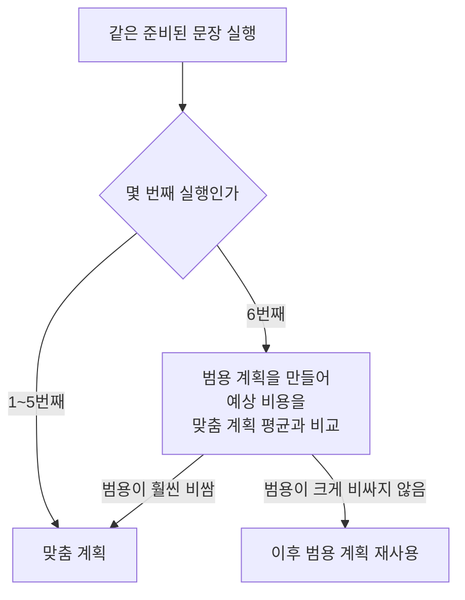
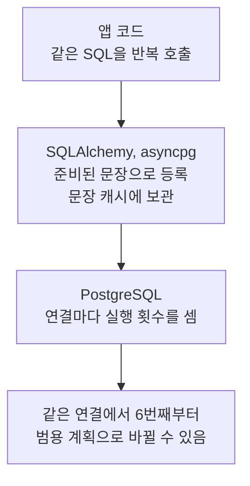
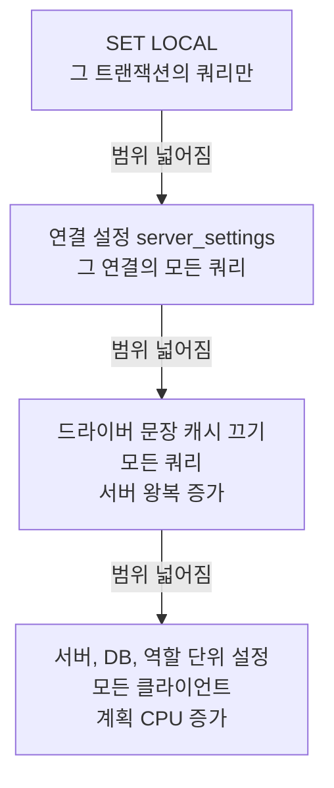

# plan_cache_mode 정리

PostgreSQL 준비된 문장(Prepared Statement)과 드라이버 문장 캐시

<!-- more -->

- 준비된 문장: SQL 모양을 서버에 등록해 두고 값만 바꿔 실행하는 방식
- 실행 계획: PostgreSQL이 쿼리를 실행하기 전에 정하는 읽기 방법. 예상 비용이 가장 낮은 계획을 고름
- 준비된 문장의 실행 계획은 두 종류


---

`plan_cache_mode`는 둘 중 무엇을 쓸지 정하는 설정

| 값 | 동작 |
|---|---|
| `auto`(기본) | 아래 규칙으로 자동 선택 |
| `force_custom_plan` | 항상 맞춤 계획 |
| `force_generic_plan` | 항상 범용 계획 |

`auto` 규칙



- 비교 기준은 예상 비용뿐. 실제 실행 시간은 보지 않음
- 범용 계획이 실제로 느려도 자동으로 되돌아가지 않음
- 파라미터가 없는 문장은 처음부터 범용 계획

---

앱 코드에 `PREPARE`가 없어도 드라이버가 준비된 문장을 자동으로 씀



| 드라이버 | 문장 캐시 설정 | 기본값 |
|---|---|---|
| asyncpg | `statement_cache_size` | 100 |
| SQLAlchemy asyncpg 방언 | `prepared_statement_cache_size` | 100 |

---

범용 계획은 값에 따라 읽을 양이 크게 다른 쿼리에서 느려짐. 값을 모르는 범위 조건(기간 등)을 무조건 0.5%로 어림하기 때문

예: 120만 행 테이블에서 작은 그룹을 1년 기간으로 조회


- 예상 비용은 범용 계획이 26배 싸 보이지만 실제로는 30배 안팎 느림
- 기간이 짧으면 범용 계획도 괜찮고 길수록 손해가 커짐

---

확인은 같은 연결에서

```sql
EXPLAIN EXECUTE pivot(200, '2025-01-01', '2025-12-31');
-- 계획에 $1, $2가 보이면 범용 계획

SELECT name, generic_plans, custom_plans FROM pg_prepared_statements;
-- generic_plans가 늘고 있으면 범용 계획 사용 중
```

- `EXPLAIN EXECUTE`도 실행 횟수에 포함
- `EXPLAIN (GENERIC_PLAN)`으로 범용 계획을 실행 없이 미리 볼 수 있음

---

해결은 적용 범위가 좁을수록 부작용이 적음



권장은 값에 민감한 쿼리의 트랜잭션에만 `SET LOCAL`

```python
async with engine.begin() as conn:
    await conn.execute(text("SET LOCAL plan_cache_mode = force_custom_plan"))
    result = await conn.execute(query, params)
```

- 다른 쿼리는 범용 계획의 이점을 그대로 누림
- `SET LOCAL`은 트랜잭션 안에서만 동작. 밖에서 쓰면 오류 없이 무시됨
- 이미 준비된 문장에도 바로 적용됨

| 기능 | 필요 버전 |
|---|---|
| `plan_cache_mode` | PostgreSQL 12 |
| `pg_prepared_statements`의 `generic_plans`, `custom_plans` | PostgreSQL 14 |
| `EXPLAIN (GENERIC_PLAN)` | PostgreSQL 16 |
